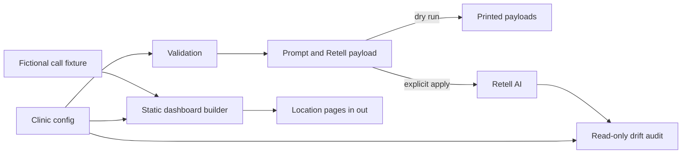

# AI Voice Receptionist for Clinics

A configuration-driven Retell AI receptionist that creates one agent per clinic location, audits live configuration drift, and builds a static call operations dashboard.

## Why I built it

I built this because a clinic can lose a new patient when a call reaches voicemail, but a careless voice agent can create a bigger problem by inventing availability or giving clinical advice. So the engineering focuses on three things: each location is driven by its own config, the live agent is audited against that config, and the agent fails safely when it does not know an answer.

## How it works



- One JSON record controls each location's hours, services, booking rules, voice, timezone, and Retell environment variable names.
- Prompt generation is deterministic. The same validated config drives creation and audit expectations.
- Dry run is the default. Live creation needs an API key plus two explicit command flags.
- The auditor compares selected live agent and LLM fields exactly, including the complete prompt.
- The site builder creates an overview plus a call log page for every configured location.

## Guardrails

- No clinical advice: the prompt blocks diagnosis, triage, treatment recommendations, dosing, and care instructions.
- Emergency exit: serious symptoms are directed to 911 or an emergency department without continuing intake.
- Minimum necessary data: the receptionist asks only for contact details, requested service, and timing.
- No invented facts: only configured services, hours, and administrative guidance may be stated.
- Honest booking state: the demo records appointment requests and never claims a booking is confirmed.
- Structured hours: 24 hour time ranges are validated for bad values and overlaps before a payload is built.
- Fail-closed configuration: missing safety fields, unknown booking modes, duplicate locations, and invalid timezones stop execution.
- Drift is visible: the audit exits with status 1 when live behavior differs from config, which makes it useful in CI.
- Secrets and resource IDs stay outside the repo: the API key and live Retell IDs come only from environment variables.

## Quick start

The full demo runs offline with two fictional clinics. It prints both Retell API payloads, finds the deliberate drift in mocked live data, and builds the dashboard to `./out/`.

```bash
python3 scripts/demo.py
open out/index.html
```

Run each stage separately:

```bash
python3 scripts/create_agents.py
python3 scripts/audit_agents.py
python3 scripts/build_site.py --out ./out
```

The mock audit intentionally exits with status 1 because Harbor Glow has a changed voice and greeting. That is the expected demonstration result.

For real Retell use, copy the placeholder environment file, choose supported voice IDs in the config, and export the values in your shell. Do not commit `.env`.

```bash
cp .env.example .env
export RETELL_API_KEY="your_key"
python3 scripts/create_agents.py --apply --confirm CREATE
```

Store the returned resource IDs in the environment variables named by each location's `retell` block. A live audit is read-only:

```bash
export RETELL_AGENT_ID_NORTHWIND="your_agent_id"
export RETELL_LLM_ID_NORTHWIND="your_llm_id"
export RETELL_AGENT_ID_HARBOR_GLOW="your_agent_id"
export RETELL_LLM_ID_HARBOR_GLOW="your_llm_id"
python3 scripts/audit_agents.py --live
```

## Example output

```text
DRY RUN: no network calls will be made
Generated 2 location payloads

RETELL CONFIGURATION AUDIT
Locations: 2 | Match: 1 | Drift: 1
[MATCH] northwind-dental-riverside
[DRIFT] harbor-glow-medical-spa
  agent.voice_id: expected "11labs-Dorothy"; actual "demo-voice-wrong"
  llm.begin_message: expected configured greeting; actual shortened greeting

Built 4 files in out
```

## Tests

```bash
python3 -m pip install -r requirements.txt
python3 -m pytest
```

The suite checks config rejection paths, healthcare prompt boundaries, niche separation, dry-run behavior, deliberate drift detection, CLI exit codes, and generated pages.

## Tech

- Python 3.11 or newer
- Python standard library for configuration, API calls, and static generation
- Retell AI HTTP API for optional live agent creation and read-only inspection
- Pytest 8 for offline tests
- Static HTML and CSS with no build tool or client framework

## Project structure

```text
config/       Fictional location configuration
fixtures/     Fictional mocked live state and call logs
prompts/      Receptionist prompt template
scripts/      Create, audit, site build, and end-to-end demo commands
src/          Validation, prompt, payload, Retell, audit, and site modules
tests/        Offline unit and CLI tests
```

## License

MIT. Copyright (c) 2026 Christian Terrone.
